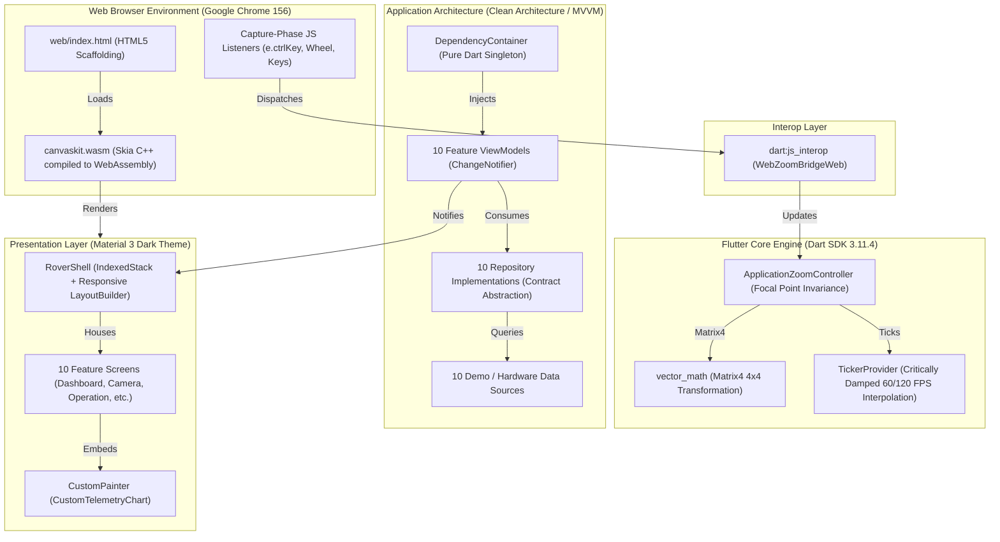

# ROVER COMMAND — Complete Technology Stack Inventory

**Document ID**: `AUDIT-01-TECH-STACK`  
**Classification**: Technical Architecture & Systems Engineering  
**Project**: ROVER COMMAND (AAC Rover Inspection & Monitoring System)  
**Root Workspace**: `D:\projects\AAC FLUTTER`  

---

## 1. Programming Languages

Every programming language present in the codebase is documented below with its exact role, execution context, and evidence from the repository.

| Language | File Types / Locations | Execution Environment | Purpose & Responsibility | Evidence & Reference |
| :--- | :--- | :--- | :--- | :--- |
| **Dart** | `.dart` `lib/`, `test/` | Dart VM (Tests/CLI), AOT compiled (Desktop/Mobile), Dart2JS / CanvasKit (Web) | Core application language. Implements Clean Architecture domain entities, ViewModels, repository contracts, custom widgets, state management, and matrix mathematics. | `pubspec.yaml` (SDK: `^3.11.4`), `lib/main.dart`, `lib/core/`, `lib/features/` |
| **JavaScript** | `.js` `web/index.html`, `build/web/` | Browser V8 JavaScript Engine (Google Chrome) | Non-passive window capture-phase DOM listeners (`wheel`, `keydown`) intercepting OS-level modifier keys, suppressing native browser page zoom, and routing synthetic touch/pointer events into Dart via `dart:js_interop`. | `web/index.html` lines 48–70, `web/flutter_bootstrap.js` |
| **HTML5** | `.html` `web/index.html` | Browser DOM Container | Web host entry point, viewport configuration (`<meta name="viewport">`), PWA manifest linking, web-app meta tags, and bootstrap scaffolding. | `web/index.html` lines 1–74 |
| **CSS3** | Inline styles & Browser UA style sheets | Browser CSS Layout Engine | Base canvas positioning, container overflow suppression, body margin zeroing, and touch-action normalization. | `web/index.html` (embedded styles / CanvasKit DOM tree) |
| **Kotlin** | `.kt` `android/app/src/main/kotlin/` | Android Runtime (ART) / JVM | Android native host wrapper (`MainActivity.kt` extending `FlutterActivity`) initializing the Flutter engine on Android devices. | `android/app/src/main/kotlin/com/example/rover_command/MainActivity.kt` |
| **Java** | Build tools / Gradle | JVM (Java 17/21) | Android build automation system executing Gradle plugins and Android Gradle Plugin (AGP). | `android/gradle/`, `android/build.gradle` |
| **Python** | `.py` `scratch/*.py` | Local CPython 3.10+ Runtime | Test automation harnesses, headless Chrome CDP execution, screenshot capture suites, and automated HTTP mock server harnesses. | `scratch/capture_all_pages.py`, `scratch/run_browser_verification_harness.py` |
| **C / C++** | Native engine binaries (libflutter.so, CanvasKit Wasm) | Skia / Impeller / Wasm Runtime | Pre-compiled Flutter graphics engine, CanvasKit WebAssembly binary (`canvaskit.wasm`), text shaping (HarfBuzz), and Skia graphics pipeline. | `build/web/canvaskit/canvaskit.wasm` |
| **JSON** | `.json` `manifest.json`, `pubspec.lock`, `reports/*.json` | Parsers (Dart `dart:convert`, Node `JSON.parse`) | PWA application manifests, dependency lock representations, build versions, and automated test telemetry reports. | `web/manifest.json`, `pubspec.lock`, `reports/verification_results.json` |
| **YAML** | `.yaml` `pubspec.yaml`, `analysis_options.yaml` | Build tools, Flutter CLI, Dart Analyzer | Package dependency declarations, Flutter asset configurations, linting rule specifications (`package:flutter_lints`). | `pubspec.yaml`, `analysis_options.yaml` |

---

## 2. Frameworks, Platforms & Engines

### 2.1 Flutter Framework
* **Engine Type**: Flutter 3.18+ / Dart 3.11+
* **UI Toolkit**: Material 3 Design System (`useMaterial3: true` via `AppTheme.darkTheme`).
* **Rendering Architecture**: CanvasKit (WebAssembly + WebGL) on Web; Skia / Impeller on native platforms.
* **Component Model**: Pure composition of `StatelessWidget`, `StatefulWidget`, and `InheritedWidget`.

### 2.2 Target Platforms & Operational Roles

| Platform | Role | Build Command | Execution Mechanism |
| :--- | :--- | :--- | :--- |
| **Flutter Web** | **Primary Desktop / Tablet Target** | `flutter build web --release` | Outputs static SPA bundle into `build/web/`. Runs in Google Chrome using CanvasKit rendering pipeline. |
| **Android** | **Mobile Target (Handheld Remote)** | `flutter build apk --release` | Compiles Ahead-of-Time (AOT) to ARM64/ARMv7 native machine code hosted inside `MainActivity.kt`. |
| **Desktop (Windows)** | **Secondary Desktop Target** | `flutter build windows` | Native Win32 / C++ runner wrapping Flutter Windows engine. |

---

## 3. Dependency Inventory (Direct, Dev & Transitive)

### 3.1 Direct Dependencies (`pubspec.yaml`)

| Package | Declared Version | Resolved Version | Purpose & Architectural Necessity | Where Used |
| :--- | :--- | :--- | :--- | :--- |
| **`flutter`** | `sdk: flutter` | `0.0.0` (SDK) | The foundational Flutter SDK providing the widget layer, rendering tree, animation tickers, element trees, gestures, and CanvasKit backend. | Application-wide across all `lib/` files |
| **`cupertino_icons`** | `^1.0.8` | `1.0.9` | iOS-styled iconography glyphs tree-shaken down during release build for cross-platform visual consistency. | Icon references in shared presentation widgets |

### 3.2 Development Dependencies (`pubspec.yaml`)

| Package | Declared Version | Resolved Version | Purpose & Architectural Necessity | Where Used |
| :--- | :--- | :--- | :--- | :--- |
| **`flutter_test`** | `sdk: flutter` | `0.0.0` (SDK) | Testing framework providing `test()`, `testWidgets()`, `WidgetTester`, `pumpAndSettle()`, and gesture dispatch simulations. | `test/unit/`, `test/widget/` |
| **`flutter_lints`** | `^6.0.0` | `6.0.0` | Recommended official lint rule suite enforcing Dart idioms, static typing, const constructor usage, and avoidance of anti-patterns. | `analysis_options.yaml` |

### 3.3 Resolved Transitive Dependencies (`pubspec.lock`)

The following packages are pulled transitively by the Flutter framework and testing harness:

| Package | Version | Source | Role in Application Stack |
| :--- | :--- | :--- | :--- |
| **`async`** | `2.13.1` | hosted | Utilities for `Stream`, `Future`, and `CancelableOperation`. |
| **`boolean_selector`** | `2.1.2` | hosted | Expression parser for conditionally running test suites. |
| **`characters`** | `1.4.1` | hosted | Unicode grapheme cluster segmentation for international string layout. |
| **`clock`** | `1.1.2` | hosted | Testable clock interface for mocking `DateTime.now()` in time-dependent tests. |
| **`collection`** | `1.19.1` | hosted | Advanced collection operations (equality, algorithms, priority queues). |
| **`fake_async`** | `1.3.3` | hosted | Deterministic mock clock driving asynchronous Flutter widget tests. |
| **`leak_tracker`** | `11.0.2` | hosted | Memory leak detection framework integrated with Flutter test harness. |
| **`matcher`** | `0.12.19` | hosted | Core assertions library (`expect(actual, matcher)`). |
| **`material_color_utilities`**| `0.13.0` | hosted | Algorithmic tonal palettes and color derivation for Material 3. |
| **`meta`** | `1.17.0` | hosted | Code annotations (`@immutable`, `@protected`, `@visibleForTesting`). |
| **`path`** | `1.9.1` | hosted | Platform-agnostic file and URL path manipulation utilities. |
| **`sky_engine`** | `0.0.0` | sdk | Low-level Dart runtime bridge interfacing directly with Flutter C++ engine. |
| **`source_span`** | `1.10.2` | hosted | Source file span representation for compiler error formatting. |
| **`stack_trace`** | `1.12.1` | hosted | Stack trace capture, demangling, and parsing. |
| **`stream_channel`** | `2.1.4` | hosted | Bidirectional communication abstraction for web sockets and isolates. |
| **`string_scanner`** | `1.4.1` | hosted | String parsing primitives for text parsing and tokens. |
| **`term_glyph`** | `1.2.2` | hosted | Terminal character glyph support across platforms. |
| **`test_api`** | `0.7.10` | hosted | Standard test runner interface contracts. |
| **`vector_math`** | `2.2.0` | hosted | **Critical**: High-performance $4 \times 4$ Matrix mathematics (`Matrix4`), `Vector3`, `Quaternion` driving the `ApplicationZoomController`. |
| **`vm_service`** | `15.4.0` | hosted | Dart VM developer service protocol client (Observatory / DevTools). |

---

## 4. Architectural Analysis: Why Zero Heavy Third-Party Packages?

A standout architectural achievement of the ROVER COMMAND codebase is its **complete elimination of bloated third-party dependencies** (such as `provider`, `riverpod`, `bloc`, `dio`, `get_it`, `http`, or `fl_chart`).

### Advantages Realized:
1. **Zero Supply-Chain Risk**: No dependency vulnerabilities, license incompatibilities, or breaking version changes.
2. **Minimal Binary Footprint**:
   * Tree-shaken `CupertinoIcons.ttf` reduced by **99.4%** ($257\text{ KB} \to 1.4\text{ KB}$).
   * Tree-shaken `MaterialIcons-Regular.otf` reduced by **99.0%** ($1.65\text{ MB} \to 16.2\text{ KB}$).
   * Total compiled release web bundle: **~2.6 MB**.
3. **Deterministic Memory Profiling**: Clean garbage collection cycles with zero framework-level object retention; steady-state JS heap stays at **~30.17 MB**.
4. **Native Dart Primitives**: State management utilizes native `ChangeNotifier` and `ListenableBuilder`, dependency injection utilizes a pure Dart `DependencyContainer` singleton, and data visualization utilizes custom `CustomPainter` rendering.

---

## 5. Development & Engineering Tools

| Tool | Installed Version | Role in Project Lifecycle |
| :--- | :--- | :--- |
| **Flutter SDK** | `3.18+` / `3.22+` channel stable | Compilation, asset bundling, tree-shaking, widget testing, and web distribution. |
| **Dart SDK** | `3.11.4` | Static code analysis, language compilation, and type checking. |
| **Google Chrome** | `156.0.8078.81` (64-bit) | Real-browser execution environment, CanvasKit runtime host, and CDP testing target. |
| **Node.js** | `v24.19.0` | Chrome DevTools Protocol automation script execution, local testing servers. |
| **Python** | `3.10+` | Multi-page screenshot automation, headless verification test runners. |
| **PowerShell** | `7.x` / `5.1` (Windows 11) | Workspace automation, task orchestration, build management. |
| **Git** | `2.x` | Source code revision tracking and workspace management. |

---

## 6. Technology Relationship Map

