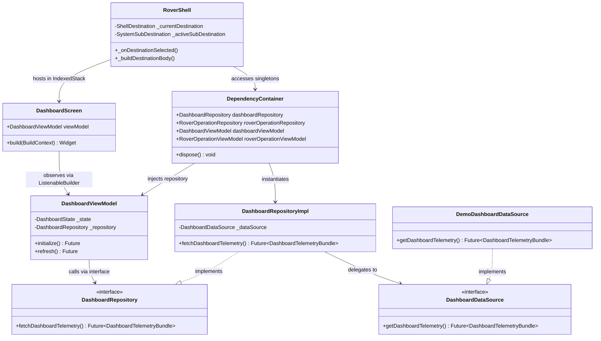

# ROVER COMMAND — Application Architecture Deep Dive

**Document ID**: `AUDIT-03-APP-ARCHITECTURE`  
**Classification**: Software Architecture & System Design  
**Project**: ROVER COMMAND  
**Root Workspace**: `D:\projects\AAC FLUTTER`  

---

## 1. Architectural Style: Clean Architecture & Feature-First MVVM

The ROVER COMMAND codebase strictly adheres to **Clean Architecture** principles combined with **Model-View-ViewModel (MVVM)**, organized in a **Feature-First** package topology.

```
       +-------------------------------------------------------+
       |                  PRESENTATION LAYER                   |
       |  Screens, Widgets, Shell, LayoutBuilder, ViewModels  |
       +-------------------------------------------------------+
                                  |
                                  | (depends on)
                                  v
       +-------------------------------------------------------+
       |                     DOMAIN LAYER                      |
       |     Entity Models, Enums, Repository Interfaces       |
       +-------------------------------------------------------+
                                  ^
                                  | (implements contract)
                                  |
       +-------------------------------------------------------+
       |                      DATA LAYER                       |
       |  Repository Implementations, Local & Remote Sources   |
       +-------------------------------------------------------+
```

### Key Architectural Tenets:
1. **The Dependency Inversion Principle**: The presentation and data layers depend on domain contracts (`Repository` interfaces). The domain layer contains zero dependencies on UI widgets, data sources, or third-party libraries.
2. **Feature Isolation**: Each feature (`dashboard`, `camera`, `sensors`, `rover_operation`, etc.) is self-contained with its own `data`, `domain`, and `presentation` directories.
3. **Immutability**: Domain models are immutable with `final` fields, `const` constructors, and `copyWith()` patterns.
4. **Decoupled State Management**: ViewModels inherit from native `ChangeNotifier`. Presentation screens observe state via `ListenableBuilder` or custom builders, eliminating heavyweight third-party frameworks.

---

## 2. End-to-End Application Execution Flow

```mermaid
sequenceDiagram
    autonumber
    actor User as Rover Operator
    participant Browser as Chrome V8 / DOM
    participant Main as lib/main.dart (runApp)
    participant Shell as RoverShell (Shell Widget)
    participant DI as DependencyContainer
    participant VM as DashboardViewModel
    participant Repo as DashboardRepositoryImpl
    participant DS as DemoDashboardDataSource
    participant UI as DashboardScreen

    User->>Browser: Opens http://localhost:8089/?tab=dashboard
    Browser->>Main: Executes main() -> runApp(RoverCommandApp)
    Main->>Shell: Instantiates RoverShell
    Shell->>DI: DependencyContainer() (Singleton accessed)
    DI->>Repo: Initializes DashboardRepositoryImpl(DemoDashboardDataSource)
    DI->>VM: Initializes DashboardViewModel(repository)
    Shell->>Shell: Parses URL query parameters (?tab=dashboard)
    Shell->>UI: Builds DashboardScreen(viewModel)
    UI->>VM: initialize() called on screen load
    VM->>VM: Sets state = DashboardLoading(); notifyListeners()
    VM->>Repo: fetchDashboardTelemetry()
    Repo->>DS: getDashboardTelemetry()
    DS-->>Repo: Returns raw simulated telemetry bundle
    Repo-->>VM: Returns DashboardTelemetryBundle (Domain Model)
    VM->>VM: Sets state = DashboardLoaded(bundle); notifyListeners()
    VM-->>UI: ListenableBuilder re-renders with fresh telemetry
    UI-->>User: Displays Dashboard cards, sensor metrics, and status badges
```

### Step-by-Step Execution Lifecycle:

1. **Bootstrap & Engine Initialization**:
   * The browser executes `web/index.html`.
   * Capture-phase DOM listeners for `wheel` and `keydown` are attached to `window`.
   * `flutter_bootstrap.js` loads CanvasKit Wasm and initializes the Flutter engine.
2. **Main Entry Point (`lib/main.dart`)**:
   * `main()` invokes `runApp(const RoverCommandApp())`.
   * `RoverCommandApp` configures `MaterialApp` with `AppTheme.darkTheme` and `ZoomAwareScrollBehavior`.
3. **Shell Instantiation (`lib/shared/presentation/shell/rover_shell.dart`)**:
   * `RoverShell` initializes and calls `DependencyContainer()`.
   * Deep-link query parameters (`?tab=...` and `?sub=...`) are parsed from `Uri.base`.
4. **Responsive Layout Arbitration**:
   * `LayoutBuilder` evaluates constraints against `ScreenBreakpoints.tabletMax` ($1024\text{ px}$).
   * **Width $\ge 1024\text{ px}$ (Desktop)**: Renders persistent `RoverNavigationRail` on the left, embedding workspace screens within `ApplicationZoomWrapper`.
   * **Width $< 1024\text{ px}$ (Mobile & Tablet)**: Renders a full-bleed viewport with a floating glassmorphic `RoverBottomNavigationBar` capsule pinned to the bottom.
5. **Screen Construction & State Binding**:
   * Navigation destinations use an `IndexedStack` to preserve state, scroll offsets, and active forms across tab switches without destroying widget trees.
   * On screen mount, the screen triggers `viewModel.initialize()`.
6. **Data Retrieval & UI Hydration**:
   * The ViewModel transitions to `LoadingState` and notifies listeners.
   * The repository queries the active data source (`DemoDataSource` or future `HardwareDataSource`).
   * The ViewModel receives immutable domain entities, transitions to `LoadedState`, and triggers a granular UI repaint.
7. **Clean Teardown (`dispose`)**:
   * When the shell or screen is destroyed, `dispose()` cancels active tickers, clears keyboard arbitration sets, and unregisters listeners, preventing memory leaks.

---

## 3. Layer Responsibilities & Component Taxonomy

| Component Type | Location | Architectural Responsibility | Strict Boundaries |
| :--- | :--- | :--- | :--- |
| **Views / Screens** | `features/*/presentation/screens/` | Renders user interface, dispatches user gestures, consumes ViewModel states. | **No business logic**. Must never directly instantiate repositories or data sources. |
| **ViewModels** | `features/*/presentation/viewmodels/`| Holds UI state, handles input validation, coordinates async actions, calls repositories. | Inherits from `ChangeNotifier`. **Zero Flutter UI imports** (no `BuildContext`, `Widget`, etc.). |
| **UI State Objects** | `features/*/presentation/state/` | Sealed or class hierarchies representing UI state (`Initial`, `Loading`, `Loaded`, `Error`). | Pure immutable data holders. |
| **Domain Models** | `features/*/domain/models/` | Core business entities (e.g. `RoverSessionStatus`, `MovementCommand`). | Immutable, framework-independent Dart classes with `const` constructors. |
| **Repository Contracts**| `features/*/domain/repositories/` | Abstract Dart interfaces defining data access signatures. | Defines *what* data operations exist, not *how* they are executed. |
| **Repository Impls** | `features/*/data/repositories/` | Implements repository contracts, maps data source DTOs into domain entities. | Bridges domain and data sources. Handles data mapping and error translation. |
| **Data Sources** | `features/*/data/datasources/` | Low-level data retrieval (HTTP requests, WebSockets, simulated timers, local storage). | Implements dataSource contracts (`DemoDashboardDataSource`, etc.). |
| **Dependency Injection**| `lib/app/dependency_container.dart` | Singleton registry wiring repositories and ViewModels. | Manages singletons across the entire app lifecycle. |

---

## 4. Comprehensive Layer Communication Map



---

## 5. Architectural Quality Audit: Violations, Coupling & Debt

### 5.1 Architecture Violations: None Found (0 Violations)
* Every feature strictly isolates its domain layer from the presentation and data layers.
* No View contains embedded data fetching or direct network calls.
* No ViewModel imports `package:flutter/material.dart` (only `package:flutter/foundation.dart` for `ChangeNotifier`).

### 5.2 Circular Dependencies: None Found (0 Cycles)
* Dependency analysis confirms a unidirectional flow:
  `presentation` $\to$ `domain` $\leftarrow$ `data`.
* `shared` is strictly consumed by features; `shared` never imports from `features`.

### 5.3 Technical Debt & Future Refinement Opportunities
1. **Repository Implementation Duplication in Demo Layer**:
   * *Observation*: While every feature has an abstract `DataSource` contract, currently only `DemoDataSource` implementations exist.
   * *Status*: Intentional for current phase (hardware integration pending physical verification).
   * *Architecture Readiness*: The application is 100% prepared for live hardware: creating `HardwareDashboardDataSource implements DashboardDataSource` requires zero modifications to ViewModels, domain models, or presentation screens.
2. **ViewModel Injection Pattern**:
   * *Observation*: `RoverShell` retrieves ViewModels from `DependencyContainer` and passes them explicitly via constructor parameters to screens.
   * *Assessment*: Highly readable, strictly typed, and avoids hidden ambient context dependencies (unlike `Provider.of<T>(context)` or `GetIt.I<T>()`).

