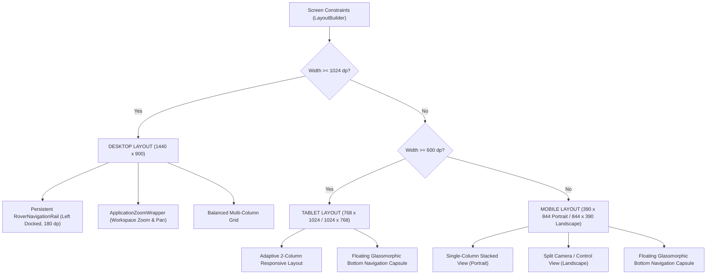

# ROVER COMMAND — Frontend & UI Implementation Architecture

**Document ID**: `AUDIT-04-FRONTEND-UI`  
**Classification**: UI/UX Engineering & Responsive Layout Systems  
**Project**: ROVER COMMAND  
**Root Workspace**: `D:\projects\AAC FLUTTER`  

---

## 1. UI Design Tokens & Theme Specification

The application implements a custom dark industrial design system configured in `lib/core/theme/`.

### 1.1 Approved 8-Color Palette (`lib/core/theme/app_colors.dart`)

```
+---------------------------------------------------------------------------------+
| COLOR TOKEN        HEX VALUE     SAMPLE  ROLE & USAGE                           |
+---------------------------------------------------------------------------------+
| burgundy           #7A0D26       [■]     Session / Alert Banner, Prominent Badges|
| gold               #D1A037       [■]     Primary Accent, Active Tab, Focus Rings |
| white              #F6F6F6       [■]     Primary Text, Key Metric Values         |
| black              #000000       [■]     Camera Viewport, Inner Insets           |
| background         #101014       [■]     Application Canvas Background           |
| surface            #19191F       [■]     Cards, Control Panels, Modal Sheets     |
| surfaceRaised      #25252D       [■]     Borders, Dividers, Raised Buttons       |
| textSecondary      #C6C6C7       [■]     Labels, Units, Timestamps, Disclaimers  |
+---------------------------------------------------------------------------------+
```

### 1.2 Typography System (`lib/core/theme/app_typography.dart`)

| Typography Token | Font Family | Size | Weight | Letter Spacing | Purpose |
| :--- | :--- | :--- | :--- | :--- | :--- |
| `AppTypography.displayLarge` | Inter | $28.0$ | Bold (700) | $-0.5$ | Major Page Titles |
| `AppTypography.headlineMedium`| Inter | $20.0$ | Semi-Bold (600) | $-0.2$ | Card Headers, Section Titles |
| `AppTypography.titleMedium` | Inter | $15.0$ | Medium (500) | $0.0$ | Card Subtitles, Navigation Items |
| `AppTypography.bodyMedium` | Inter | $13.0$ | Regular (400) | $0.1$ | Descriptive copy, disclaimer text |
| `AppTypography.monoMetric` | JetBrains Mono | $24.0$ | Bold (700) | $-0.5$ | Primary Sensor Telemetry Values |
| `AppTypography.monoLabel` | JetBrains Mono | $12.0$ | Medium (500) | $0.2$ | Units (`cm`, `m`, `lux`, `°C`), Timestamps |
| `AppTypography.badgeText` | Inter | $11.0$ | Semi-Bold (600) | $0.5$ | Status Badges (`NOT VERIFIED`, `DEMO`) |

### 1.3 Geometric Spacing & Radius Constants

* **Border Radius (`lib/core/theme/app_radius.dart`)**:
  * `small = 6.0` (Small badges, chips, inline tags)
  * `medium = 10.0` (Buttons, form fields, control arrows)
  * `large = 14.0` (Standard cards, inspection panels)
  * `pill = 999.0` (Navigation capsules, zoom HUD pill, status pills)
* **Spacing Scale (`lib/core/theme/app_spacing.dart`)**:
  * `xs = 4.0`, `sm = 8.0`, `md = 16.0`, `lg = 24.0`, `xl = 32.0`

---

## 2. Responsive Multi-Device Layout System

The layout system automatically shifts between Desktop, Tablet, and Mobile layouts using `LayoutBuilder` and `MediaQuery`.



### Breakpoint Matrix

| Viewport Profile | Width Boundary | Height | Primary Navigation Pattern | Layout Architecture |
| :--- | :--- | :--- | :--- | :--- |
| **Desktop Wide** | $\ge 1024\text{ dp}$ (typically $1440\text{ dp}$) | $900\text{ dp}$ | Left-docked `RoverNavigationRail` ($180\text{ dp}$) | Balanced 3-column arrangement: Col 1 Status/Inventory, Col 2 Camera, Col 3 Distance/Motion |
| **Tablet Portrait** | $600\text{ dp} - 1023\text{ dp}$ ($768\text{ dp}$) | $1024\text{ dp}$| Floating bottom pill navigation ($90\text{ dp}$ inset) | Adaptive 2-column card layout |
| **Mobile Portrait** | $< 600\text{ dp}$ ($390\text{ dp}$) | $844\text{ dp}$ | Floating bottom pill navigation | Single vertical scrollable column with full-width cards |
| **Mobile Landscape**| $< 600\text{ dp}$ height ($844\text{ dp}$ width)| $390\text{ dp}$ | Floating bottom pill navigation | 50/50 horizontal split: Left Camera HUD, Right D-Pad + Status |

---

## 3. Detailed Screen Implementations (All 10 Screens)

### 3.1 Screen 01: Dashboard (`lib/features/dashboard/presentation/screens/dashboard_screen.dart`)
* **Role**: Primary inspection hub presenting high-level rover session status, hardware inventory, camera preview, and live sensor summaries.
* **Component Widgets**:
  * `RoverStatusAlertBanner`: High-contrast burgundy alert panel with `ROVER-01`, `NOT VERIFIED` pill, and `Simulated data only — No live connection` disclaimer.
  * `HardwareOverviewGrid`: 4 summary cards (Battery `12V Li-ion`, Controller `2x ESP32 DevKit`, Camera `ESP32-CAM`, Hardware Assembly `Assembly pending`).
  * `CameraPreviewCard`: 16:9 placeholder viewport with camera icon, `NO VIDEO FEED / NOT CONNECTED`, and connection retry action.
  * `DistanceSensorsSection` & `DistanceSensorCard`: Dual HC-SR04 ultrasonic cards displaying `124 cm` and `86 cm` with validity badges.
  * `MotionSensorsSection` & `MotionSensorCard`: Dual RCWL-0516 microwave radar cards displaying `CLEAR` and `MOTION DETECTED` states.

### 3.2 Screen 02: Camera (`lib/features/camera/presentation/screens/camera_screen.dart`)
* **Role**: Dedicated ESP32-CAM inspection stream viewer with stream health diagnostics and configuration parameters.
* **Component Widgets**:
  * `CameraStreamViewport`: Full-resolution camera viewport showing feed status, technical resolution, frame rate, and reconnection CTA.
  * `CameraInfoCard`: Module status table (Module, Connection, Last Update, Stream Health, Frame Dimensions).
  * `OpenDiagnosticsCTA`: Secondary button routing directly to `System -> Diagnostics`.

### 3.3 Screen 03: Sensors (`lib/features/sensors/presentation/screens/sensors_screen.dart`)
* **Role**: Detailed sensor telemetry analysis with historical trend charting.
* **Component Widgets**:
  * `SensorMetricsSummaryCard`: 4 summary stat blocks (Total: 4, Available: 4, Unverified: 4, Issues: 0).
  * `SensorsDistanceCard`: HC-SR04/01 and HC-SR04/02 live distance readings with error threshold indicators.
  * `SensorsMotionCard`: RCWL-0516/01 and RCWL-0516/02 motion sensor event triggers.
  * `SensorsRecentActivityCard`: Embeds `CustomTelemetryChart` (custom-painted line chart rendering deterministic historical distance deltas over time).

### 3.4 Screen 04: Rover Operation (`lib/features/rover_operation/presentation/screens/rover_operation_screen.dart`)
* **Role**: Real-time remote rover control center supporting directional movement, keyboard controls, Emergency Stop, and live sensor monitoring.
* **Layout Modes**:
  * `DesktopNormalLayout`: Side-by-side viewport and control panel.
  * `DesktopExpandedLayout`: Maximized camera feed with compact floating HUD overlays.
  * `MobilePortraitLayout`: Vertical stacked controls optimized for single-hand thumb reach.
  * `MobileLandscapeExpandedLayout`: Split landscape layout mimicking professional drone / rover transmitters.
* **Component Widgets**:
  * `DirectionalControlPad`: Ergonomic 4-way D-Pad (Up, Down, Left, Right) with visual press feedback, hover states, and touch cancellation protection.
  * `EmergencyStopButton`: High-visibility red glowing action button with immediate synchronous motor halt lock.
  * `CameraHudViewport`: Camera feed featuring tactical HUD crosshairs, FPS counters, resolution badges, and latency indicators ($48\text{ ms}$).
  * `LiveSensorsCard`: Quick telemetry strip (Temperature $34.2^\circ\text{C}$, Humidity $42\%$, Ultrasonic $0.87\text{ m}$, Light $1240\text{ lux}$).
  * `RoverStatusCard`: Connection status, motion state (`Idle` / `Active`), battery bar ($76\%$).
  * `HardwareHealthCard`: System subsystem indicators (Camera, Motor Driver, Controller, Sensors).

### 3.5 Screen 05: System Management (`lib/features/system/presentation/screens/system_screen.dart`)
* **Role**: Central hardware and software administration portal.
* **Component Widgets**:
  * `SystemControllersCard`: Controller telemetry for 2× ESP32 DevKit and 1× ESP32-CAM.
  * `SystemDriveHardwareCard`: Motor driver (DRV8833), DC motors, and MG90S servo actuator inventory.
  * `SystemPowerCard`: 12V Li-ion battery and buck converter voltage/current tables.
  * `SystemManagementShortcuts`: Quick-action cards navigating to the 5 secondary sub-screens.

### 3.6 Screens 06–10: Secondary Management Sub-Screens
* **06. Device Connection (`device_connection_screen.dart`)**: Device pairing interface, Wi-Fi / USB / Bluetooth discovery, and historical connection log.
* **07. Diagnostics & Health (`diagnostics_screen.dart`)**: Comprehensive health tree, active hardware issues list, and system self-test trigger.
* **08. Activity & Event Logs (`activity_logs_screen.dart`)**: Searchable, filterable event audit log with category pills (`App`, `Device`, `Sensor`, `Camera`) and severity badges (`INFO`, `WARN`, `ERROR`).
* **09. Configuration & Calibration (`configuration_screen.dart`)**: Network configuration (Station SSID, Password, IP), sensor sampling rates, and calibration offsets.
* **10. Firmware & Maintenance (`firmware_screen.dart`)**: Firmware version matrix (ESP32 DevKit v1.0.0, ESP32-CAM v1.0.0), OTA update triggers, and maintenance history.

---

## 4. Custom Graphics & Painting: `CustomTelemetryChart`

Instead of relying on heavy third-party plotting libraries (e.g. `fl_chart`), the project implements a dedicated custom painter in `lib/shared/presentation/widgets/custom_telemetry_chart.dart`.

### Features:
1. **Zero External Dependencies**: Pure Flutter `CustomPainter` using native `Canvas.drawLine()`, `Canvas.drawPath()`, and `TextPainter`.
2. **Dual-Series Rendering**: Simultaneously renders D1 (Gold line) and D2 (White dashed line) historical sensor distance series.
3. **Background Grid**: Automatically draws horizontal grid lines at calibrated $50\text{ cm}$ intervals with JetBrains Mono axis labels.
4. **GPU-Accelerated**: Wrapped in `RepaintBoundary` to prevent unnecessary repainting when other dashboard cards update.

