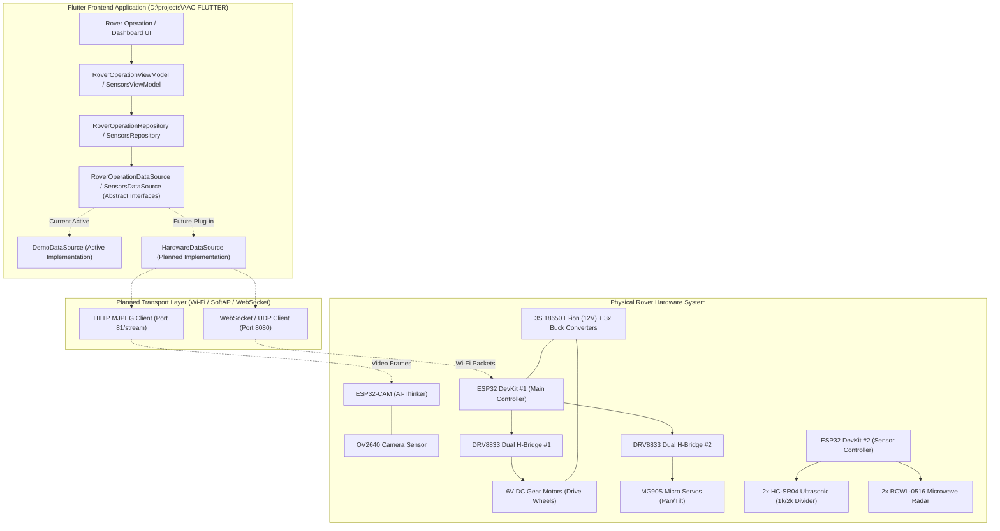

# ROVER COMMAND — IoT & Embedded Hardware Architecture

**Document ID**: `AUDIT-06-IOT-HARDWARE`  
**Classification**: Embedded Systems & Hardware-Software Interface  
**Project**: ROVER COMMAND  
**Root Workspace**: `D:\projects\AAC FLUTTER`  

---

## 1. Hardware Inventory & Circuit Schematic Audit

An exhaustive audit of the physical circuit schematic (`design_reference/hardware_circuit.jpeg`) against the Flutter codebase reveals the following component inventory:

| Physical Hardware Component | Quantity | Schematic Annotations & Wiring Details | Role in Physical System | Representation in Source Code | Integration Status |
| :--- | :--- | :--- | :--- | :--- | :--- |
| **ESP32 DevKit V1** | 2 | 38-pin dual-core Xtensa microcontrollers | Primary System / Sensor / Motor Controllers | `SystemControllersCard.dart`, `DeviceFirmwareInfo.dart` | **Simulated / Abstracted** (Ready for transport) |
| **ESP32-CAM** | 1 | AI-Thinker module, OV2640 sensor, flash LED | Inspection video feed & camera telemetry | `CameraScreen.dart`, `CameraTelemetry.dart`, `CameraStreamViewport.dart` | **Simulated / Abstracted** (UI & contracts complete) |
| **DRV8833 Motor Driver** | 2 | Dual MOSFET H-Bridge breakout boards | Bi-directional DC motor control & servo drive | `DriveHardwareTelemetry.dart`, `SystemDriveHardwareCard.dart` | **Simulated / Abstracted** |
| **18650 Li-ion Cells (12V)** | 3 cells | 3S configuration: 11.1V nominal, ~12.6V peak | Main system power source | `PowerMetrics.dart`, `SystemPowerCard.dart` | **Modeled (Unmetered)** (No ADC shunt in circuit) |
| **Buck Converters** | 3 | Step-down modules (6V for motors, 5V/3.3V for logic) | Voltage regulation | `PowerMetrics.dart`, `SystemPowerCard.dart` | **Modeled (Unmetered)** |
| **Yellow DC Gear Motors** | 2 | "Left Motor" & "Right Motor", 100 nF capacitors | Main rover drive traction | `MovementDirection.dart`, `DriveHardwareTelemetry.dart` | **Abstracted Commands** |
| **Grey DC Motors** | 2 | 100 nF suppression capacitors | Auxiliary drive / mechanical actuators | `DriveHardwareTelemetry.dart` | **Modeled** |
| **MG90S Micro Servos** | 3–4 | "Horizontal Servo", "Vertical Servo", "Bullet Loader" | Pan/tilt gimbal & mechanical payload | `DriveHardwareTelemetry.dart` | **Modeled** |
| **HC-SR04 Ultrasonic Sensors**| 2 | Front & Rear; 1kΩ / 2kΩ voltage divider on ECHO | Obstacle distance measurement ($2\text{ cm} - 400\text{ cm}$) | `DistanceSensorTelemetry.dart`, `SensorsDistanceCard.dart` | **Simulated Telemetry** |
| **RCWL-0516 Microwave Sensors**| 2 | Doppler microwave radar sensors | Proximity motion & intrusion detection | `MotionSensorTelemetry.dart`, `SensorsMotionCard.dart` | **Simulated Telemetry** |

---

## 2. Hardware Status Categorization

To avoid any confusion between software models and physical hardware:

```
+-----------------------------------------------------------------------------------+
| COMPONENT                  STATUS               CURRENT REPOSITORY REALITY        |
+-----------------------------------------------------------------------------------+
| Frontend UI & Dashboards   IMPLEMENTED          100% complete, tested & responsive|
| State Management & MVVM    IMPLEMENTED          ChangeNotifier & ViewModels active|
| Movement Command Engine    IMPLEMENTED          Touch & WASD keyboard arbitration |
| Zoom & Input System        IMPLEMENTED          Matrix4 GPU zoom, WPT pinch-ready |
| Data Layer Abstractions    IMPLEMENTED          All Repository & DataSource interfaces|
| Demo Data Generators       IMPLEMENTED          Deterministic realistic simulation|
| Live Wi-Fi/WebSocket Client PLANNED              Interface ready; transport pending|
| ESP32 Microcontroller C++  NOT IN REPOSITORY    Firmware code maintained outside  |
| ESP32-CAM MJPEG Streamer   NOT IN REPOSITORY    Firmware code maintained outside  |
| Battery Voltage Measurement HARDWARE LIMITATION  Circuit lacks ADC voltage divider |
+-----------------------------------------------------------------------------------+
```

---

## 3. Physical Circuit Analysis & Hardware Limitations

### 3.1 The Voltage / Battery Measurement Limitation
A critical discovery in `design_reference/hardware_circuit.jpeg` and `architecture/hardware_integration_requirements.md`:
* **The physical schematic contains NO voltage divider or current shunt connected from the battery or buck converters to any ESP32 analog ADC pin**.
* **Implication**: The physical microcontrollers **cannot measure battery voltage, state of charge (SoC), or buck converter voltages**.
* **Frontend Handling**: The software accurately models this limitation. In `lib/shared/domain/enums/measurement_validity.dart`, power telemetry is strongly typed as `MeasurementValidity.unavailable`, and the UI explicitly labels battery ratings as `NOMINAL RATINGS · NOT MEASUREMENTS`.

### 3.2 Inter-Microcontroller Communication Gap
The schematic depicts two ESP32 DevKit boards and one ESP32-CAM, but **no shared physical communication bus (UART cross-over, I2C with pull-ups, SPI, or CAN) is wired between them**.
* **Requirement**: When physical firmware is developed, either one DevKit must act as a master gateway (aggregating peripheral data via ESP-NOW or UART), or all three microcontrollers must connect to the same Wi-Fi network and communicate with the Flutter frontend via separate sockets.

---

## 4. Hardware-to-Software Component Interaction Architecture



---

## 5. Firmware Status & Integration Contracts

* **Firmware Existence in Repo**: There is **no C/C++ or Arduino / ESP-IDF source code** located within `D:\projects\AAC FLUTTER`. This repository is strictly the frontend application.
* **Firmware Communication Contracts**: Defined in `architecture/data_contracts.md` and `architecture/hardware_integration_requirements.md`.
* **Hardware Readiness**: To connect a real rover, an engineer only needs to create `HardwareRoverOperationDataSource implements RoverOperationDataSource` in `lib/features/rover_operation/data/datasources/` that opens a WebSocket or UDP socket. Zero presentation widgets or ViewModels need to be modified.

