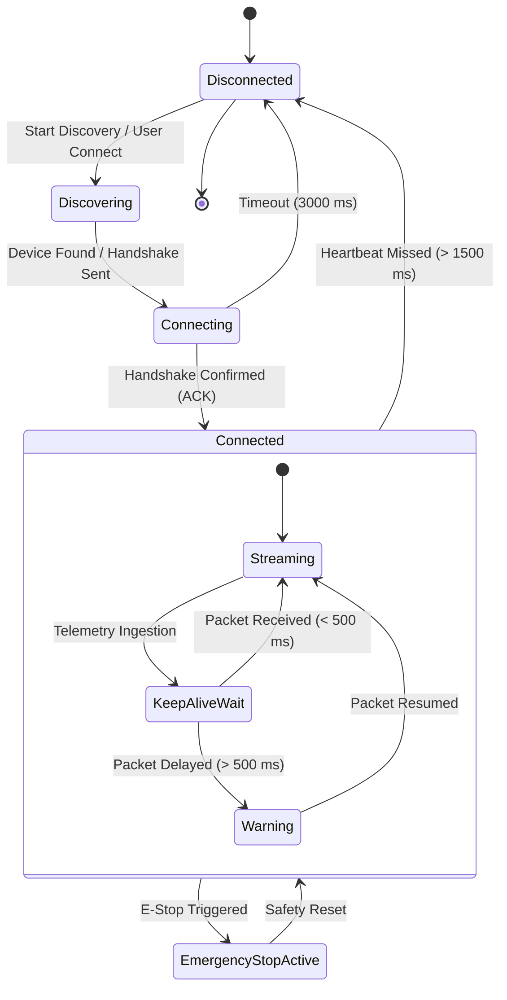

# ROVER COMMAND — Network & Communication Protocols

**Document ID**: `AUDIT-07-NETWORK-PROTOCOLS`  
**Classification**: Network Architecture & Telecommunications  
**Project**: ROVER COMMAND  
**Root Workspace**: `D:\projects\AAC FLUTTER`  

---

## 1. Network Topology & Transport Profiles

The ROVER COMMAND system architecture defines three primary deployment network topologies:

```
TOPOLOGY 1: Direct SoftAP (Ad-Hoc Field Operation)
+-----------------------------+               +-----------------------------+
|    FLUTTER GROUND STATION   |  Wi-Fi 802.11 |         ESP32 ROVER         |
|  (Tablet / Laptop / Phone)  |<------------->|       (SoftAP Gateway)      |
|    IP: 192.168.4.2          |    (No WAN)   |       IP: 192.168.4.1       |
+-----------------------------+               +-----------------------------+

TOPOLOGY 2: Infrastructure Station Mode (Field Lab / Base Station)
+-----------------------------+               +-----------------------------+
|    FLUTTER GROUND STATION   |  Local Wi-Fi  |         ESP32 ROVER         |
|      IP: 192.168.1.150      |<------------->|      IP: 192.168.1.120      |
+-----------------------------+               +-----------------------------+
                                      ^
                                      | Access Point / Router
```

| Network Profile | Physical Layer | Network Mode | Typical Latency | Primary Use Case |
| :--- | :--- | :--- | :--- | :--- |
| **Field Direct (SoftAP)** | 2.4 GHz 802.11b/g/n | ESP32 SoftAP (SSID: `ROVER-01-NET`) | $15\text{ ms} - 35\text{ ms}$ | Direct point-to-point remote field operation without external infrastructure. |
| **Lab Infrastructure** | 2.4 GHz / 5 GHz Wi-Fi | Station Mode (WPA2-PSK) | $20\text{ ms} - 50\text{ ms}$ | Extended range, multi-rover operations, telemetry logging to central server. |
| **Serial Tether (Debug)** | USB CDC Serial | 115200 / 921600 baud UART | $< 5\text{ ms}$ | Bench testing, firmware flashing, and initial calibration. |

---

## 2. Communication Protocols & Message Framing

### 2.1 Protocol Assignment by Functional Subsystem

| Subsystem | Planned Protocol | Port | Direction | Delivery Guarantee |
| :--- | :--- | :--- | :--- | :--- |
| **Rover Movement Controls** | WebSocket or UDP | `8080` (WS) / `8888` (UDP) | Client $\to$ Rover | High priority, unacknowledged rate-limited or stateful ACK |
| **Safety / Emergency Stop** | WebSocket + Binary Fallback | `8080` | Client $\to$ Rover | Immediate TCP delivery + duplicate UDP dispatch |
| **Sensor Telemetry Stream** | WebSocket or UDP Multicast | `8080` / `8889` | Rover $\to$ Client | 10 Hz – 20 Hz periodic telemetry stream |
| **Camera Video Stream** | HTTP Multipart MJPEG | `81/stream` | ESP32-CAM $\to$ Client | Continuous streaming frames ($15\text{ fps} - 30\text{ fps}$) |
| **Device Discovery** | UDP Broadcast | `9090` | Bidirectional | Multicast discovery beacons (`DISCOVER_ROVER_REQ`) |

---

## 3. Wire Protocol & Packet Specifications

### 3.1 Movement Command Packet (Client $\to$ Rover)
```json
{
  "protocol": "AAC-ROVER-v1",
  "msg_type": "CMD_MOVE",
  "seq": 1042,
  "timestamp": 1794086400250,
  "payload": {
    "direction": "FORWARD",
    "throttle": 0.85,
    "steering": 0.0,
    "timeout_ms": 250
  },
  "crc16": "0x7F2A"
}
```
* **Dead-Man Safety Timeout (`timeout_ms: 250`)**: The microcontroller firmware must implement a watchdog timer. If no new movement packet is received within $250\text{ ms}$, motors automatically brake to prevent runaway motion in case of Wi-Fi packet loss.

### 3.2 Emergency Stop Packet (Highest Priority)
```json
{
  "protocol": "AAC-ROVER-v1",
  "msg_type": "CMD_EMERGENCY_STOP",
  "seq": 1043,
  "timestamp": 1794086400280,
  "payload": {
    "action": "HALT_IMMEDIATE",
    "disable_drivers": true,
    "lockout": true
  },
  "crc16": "0xDEAD"
}
```

### 3.3 Sensor Telemetry Packet (Rover $\to$ Client)
```json
{
  "protocol": "AAC-ROVER-v1",
  "msg_type": "TELEMETRY_STREAM",
  "seq": 8941,
  "timestamp": 1794086400300,
  "rover_id": "ROVER-01",
  "payload": {
    "ultrasonic": {
      "d1_front_cm": 124.5,
      "d2_rear_cm": 86.2,
      "valid": true
    },
    "radar": {
      "motion_front": 0,
      "motion_rear": 1,
      "valid": true
    },
    "imu": {
      "pitch_deg": 0.6,
      "roll_deg": 2.1,
      "temp_c": 34.2
    },
    "power": {
      "battery_state": "UNMETERED",
      "buck_state": "NOMINAL"
    }
  }
}
```

---

## 4. Connection Lifecycle & Failure Recovery



### Heartbeat & Watchdog Specifications:
1. **Heartbeat Frequency**: Ground station sends a ping every $1000\text{ ms}$.
2. **Missing Ping Threshold**: If 3 consecutive pings fail ($> 3000\text{ ms}$), the connection is flagged as `Disconnected`.
3. **Firmware Motor Failsafe**: On the rover, if no movement command arrives within $250\text{ ms}$, motor duty cycle drops to $0\%$. If connection drops completely, DRV8833 sleep pins are pulled LOW.

