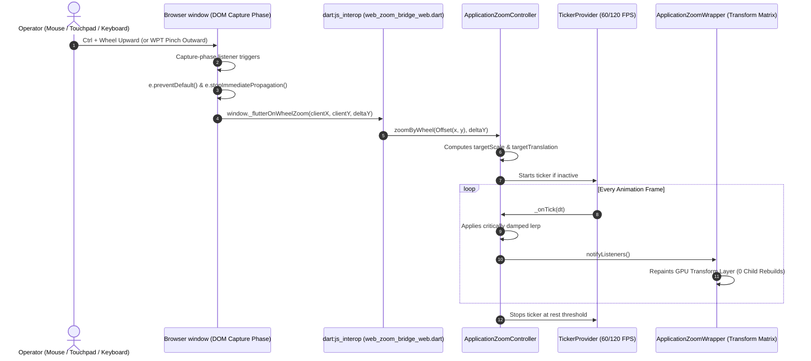

# ROVER COMMAND — Zoom & Input System Architecture

**Document ID**: `AUDIT-08-ZOOM-INPUT`  
**Classification**: High-Performance Graphics & Human Interface Architecture  
**Project**: ROVER COMMAND  
**Root Workspace**: `D:\projects\AAC FLUTTER`  

---

## 1. Overview & Architectural Challenge

A major challenge in building a professional Flutter Web desktop application is achieving smooth, cursor-anchored viewport zooming without conflicting with:
1. **Chrome's Native Page Zoom**: Chrome intercepts `Ctrl + Wheel` and `Ctrl + Plus/Minus` to zoom the entire HTML page, distorting `window.devicePixelRatio` and degrading CanvasKit crispness.
2. **Flutter Web Canvas Event Suppression**: Flutter's web canvas calls `e.preventDefault()` on raw wheel events, which blocks standard browser behaviors.
3. **Child Scrollable Stealing**: Scrollable lists (`ListView`, `SingleChildScrollView`) register in Flutter's `PointerSignalResolver` and swallow scroll events before parent zoom containers can see them.
4. **Windows Precision Touchpad (WPT) Gaps**: WPT pinch gestures fire synthetic `wheel` events with `e.ctrlKey = true` without firing physical `VK_CONTROL` keyboard events.

ROVER COMMAND solves these challenges through a unified **Dual-Bridge Graphics & Input Architecture**.

---

## 2. Mathematical Foundation of the Zoom Controller

The zoom system is implemented in `lib/core/zoom/application_zoom_controller.dart`.

### 2.1 Exponential Continuous Scaling
Standard linear delta scaling suffers from runaway speed at high zoom levels and sluggishness at low zoom levels. ROVER COMMAND applies **exponential continuous scaling**:

$$S_{\text{new}} = \text{clamp}\left(S_{\text{target}} \cdot e^{-\Delta Y \cdot 0.002},\; 0.70,\; 2.00\right)$$

* A downward wheel tick ($\Delta Y > 0$) smoothly scales down.
* An upward wheel tick ($\Delta Y < 0$) smoothly scales up.
* Boundary clamping guarantees scale remains strictly within $[0.70, 2.00]$ ($70\% - 200\%$).

### 2.2 Cursor Focal Point Invariant Translation
When zooming with a mouse or touchpad, the visual content point directly beneath the pointer must remain completely invariant in screen space:

```
Screen Pointer: P = (Px, Py)
Current Transform: Translation T_old, Scale S_old
Target Transform:  Translation T_new, Scale S_new

Content Point Under Cursor:
    C = (P - T_old) / S_old

New Translation Formula:
    T_new = P - (S_new / S_old) * (P - T_old)
```

$$\vec{T}_{\text{new}} = \vec{P} - \frac{S_{\text{new}}}{S_{\text{old}}}(\vec{P} - \vec{T}_{\text{old}})$$

### 2.3 Critically Damped Frame Interpolation
Instead of jarring step changes, continuous wheel pulses update `_targetScale` and `_targetTranslation`. A Flutter `Ticker` smoothly interpolates current values toward targets at 60/120 FPS using an exponential decay filter:

$$\text{lerpFactor} = 1.0 - e^{-25.0 \cdot \Delta t}$$

* Half-life is approximately $50\text{ ms}$.
* Stop threshold: $|\Delta S| < 0.0005$ and $|\Delta T| < 0.2\text{ px}$.
* When resting, the ticker stops automatically, consuming **zero CPU cycles**.

---

## 3. The Dual-Bridge Web Interop Architecture



### 3.1 DOM Capture-Phase Interceptors (`web/index.html`)
Attached with `{ passive: false, capture: true }` so they execute before Flutter canvas event handlers:
```javascript
// Intercept Ctrl+wheel and trackpad pinch at browser boundary
window.addEventListener('wheel', function(e) {
  if (e.ctrlKey) {
    e.preventDefault();
    e.stopImmediatePropagation();
    if (window._flutterOnWheelZoom) {
      window._flutterOnWheelZoom(e.clientX, e.clientY, e.deltaY);
    }
  }
}, { passive: false, capture: true });

// Intercept browser-level keyboard zoom shortcuts (Ctrl + '=', '-', '0')
window.addEventListener('keydown', function(e) {
  if (e.ctrlKey || e.metaKey) {
    if (e.key === '=' || e.key === '+' || e.key === '-' || e.key === '_' || e.key === '0') {
      e.preventDefault();
      e.stopImmediatePropagation();
      if (window._flutterOnKeyboardZoom) {
        window._flutterOnKeyboardZoom(e.key);
      }
    }
  }
}, { passive: false, capture: true });
```

### 3.2 Scroll Physics Coordination (`ZoomAwareScrollBehavior`)
To prevent internal scrollable lists from competing for pointer events, `ZoomAwareScrollPhysics` is registered globally in `MaterialApp`:
```dart
class ZoomAwareScrollPhysics extends ScrollPhysics {
  const ZoomAwareScrollPhysics({super.parent});

  @override
  bool shouldAcceptUserOffset(ScrollMetrics position) {
    final isCtrl = HardwareKeyboard.instance.isControlPressed ||
        HardwareKeyboard.instance.isMetaPressed;
    if (isCtrl) return false; // Hand over event to Zoom Controller
    return super.shouldAcceptUserOffset(position);
  }
}
```

---

## 4. Global Keyboard Navigation & Focus Arbitration

In `RoverShell`, global keyboard navigation is dynamically coordinated based on the active screen:

```dart
Shortcuts(
  shortcuts: _currentDestination == ShellDestination.roverOperation
      ? const <ShortcutActivator, Intent>{} // Disabled on Rover Operation to prevent conflicting focus jumps
      : const <ShortcutActivator, Intent>{
          SingleActivator(LogicalKeyboardKey.arrowUp): DirectionalFocusIntent(TraversalDirection.up),
          SingleActivator(LogicalKeyboardKey.arrowDown): DirectionalFocusIntent(TraversalDirection.down),
          SingleActivator(LogicalKeyboardKey.arrowLeft): DirectionalFocusIntent(TraversalDirection.left),
          SingleActivator(LogicalKeyboardKey.arrowRight): DirectionalFocusIntent(TraversalDirection.right),
        },
  child: FocusTraversalGroup(
    policy: ReadingOrderTraversalPolicy(),
    child: scaffold,
  ),
)
```

* **On Inspection Screens (Dashboard, System, etc.)**: Arrow keys navigate focus smoothly across cards and buttons.
* **On Rover Operation Screen**: Global arrow shortcuts are disabled so arrow keys directly drive the rover motion controller (`RoverOperationViewModel.handleKeyDown`).

