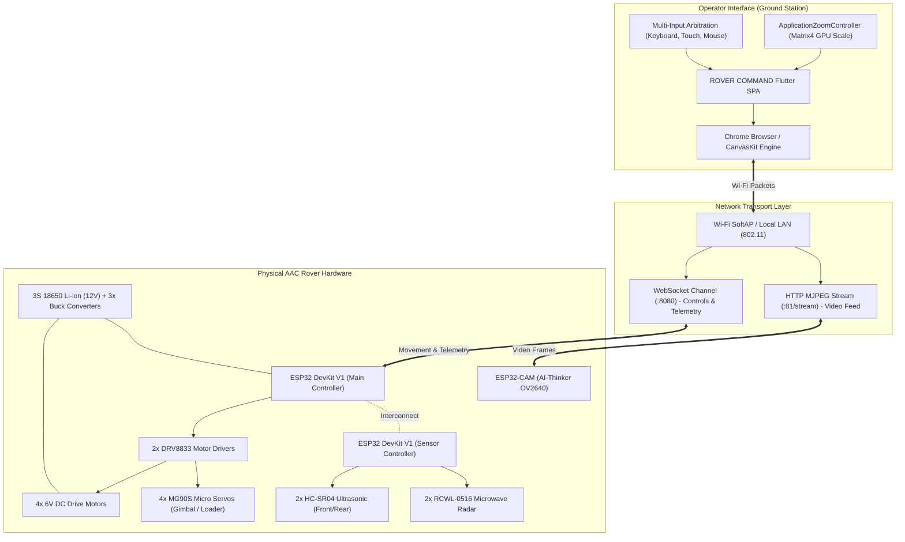
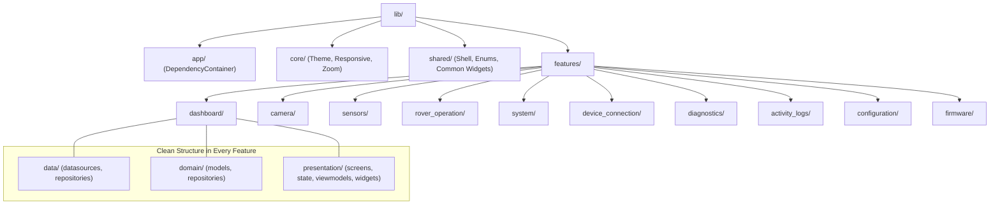
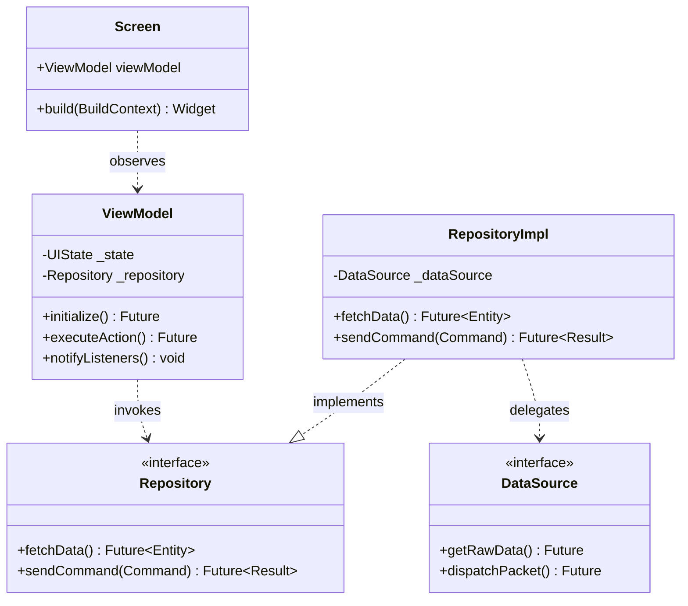
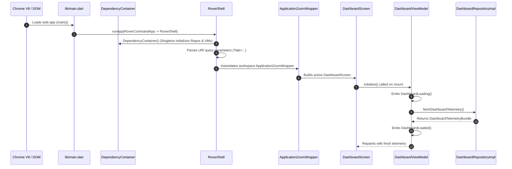
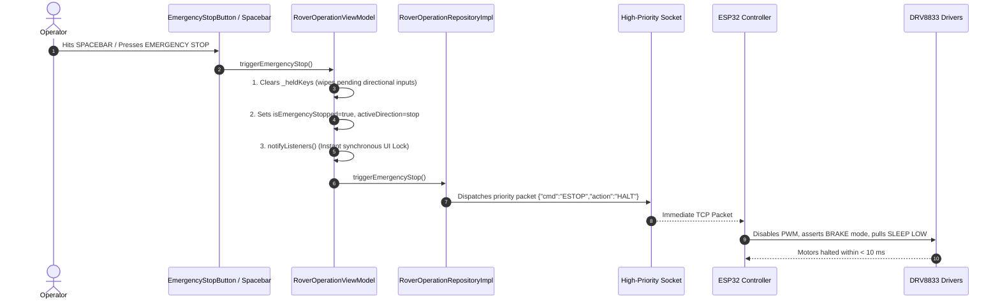
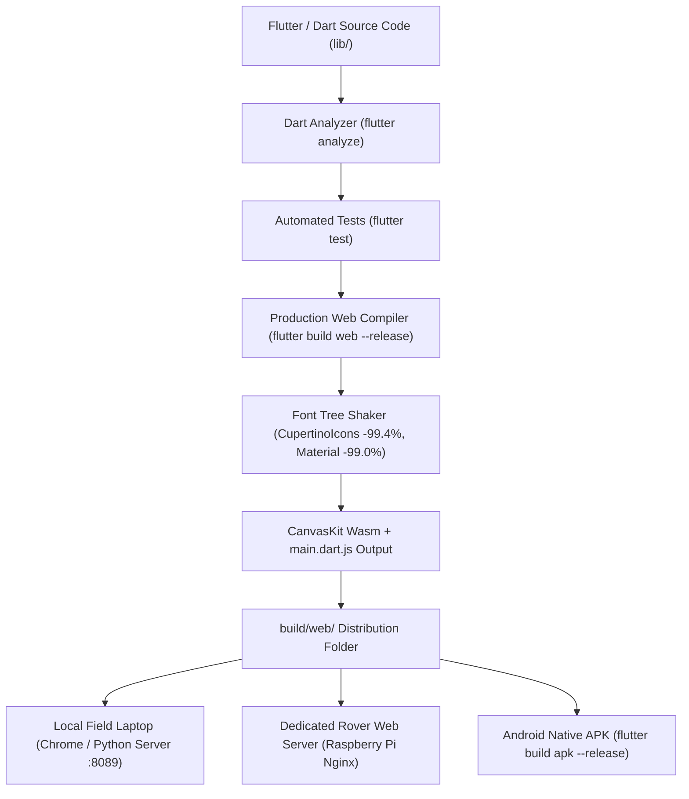

# ROVER COMMAND — Comprehensive Architecture Diagrams

**Document ID**: `AUDIT-12-DIAGRAMS`  
**Classification**: Visual Architecture & Engineering Blueprints  
**Project**: ROVER COMMAND  
**Root Workspace**: `D:\projects\AAC FLUTTER`  

---

## 1. Overall System Architecture



---

## 2. Frontend Architecture (Three-Tier Clean Architecture)

```mermaid
flowchart TD
    subgraph Presentation ["Presentation Layer (Flutter)"]
        Shell["RoverShell (Responsive Shell)"]
        NavRail["RoverNavigationRail (Desktop)"]
        NavBottom["RoverBottomNavigationBar (Mobile/Tablet)"]
        ZoomWrap["ApplicationZoomWrapper (GPU Matrix4)"]
        Screens["10 Feature Screens (Dashboard, Camera, Operation, etc.)"]
        VMs["10 Feature ViewModels (ChangeNotifier)"]
    end

    subgraph Domain ["Domain Layer (Framework-Independent)"]
        Entities["Domain Models (Immutable Value Objects)"]
        Enums["Strongly-Typed Domain Enums"]
        RepoContracts["10 Repository Interface Contracts"]
    end

    subgraph Data ["Data Layer"]
        RepoImpls["10 Repository Implementations"]
        DSContracts["10 DataSource Interfaces"]
        DemoDS["10 Demo Data Sources (Active)"]
        LiveDS["10 Hardware Data Sources (Planned)"]
    end

    Shell --> NavRail
    Shell --> NavBottom
    Shell --> ZoomWrap
    ZoomWrap --> Screens
    Screens -->|Observes via ListenableBuilder| VMs
    VMs -->|Calls via Interface| RepoContracts
    RepoContracts <|.. RepoImpls
    RepoImpls -->|Queries| DSContracts
    DSContracts <|.. DemoDS
    DSContracts <|..- LiveDS
    RepoImpls -->|Maps to| Entities
    Entities --- Enums
```

---

## 3. Feature-First Directory Structure



---

## 4. MVVM and Repository Communication Pattern



---

## 5. Application Startup Sequence



---

## 6. User-to-Hardware Remote Command Flow

```mermaid
sequenceDiagram
    autonumber
    actor Operator as Operator
    participant UI as RoverOperationScreen (D-Pad)
    participant VM as RoverOperationViewModel
    participant Repo as RoverOperationRepositoryImpl
    participant Net as WebSocket Client
    participant ESP as ESP32 Main Controller
    participant Driver as DRV8833 H-Bridge
    participant Motors as 6V DC Motors

    Operator->>UI: Presses 'W' / Taps Forward Button
    UI->>VM: handleKeyDown('W') / startMovement(forward)
    VM->>VM: Checks auto-repeat, opposing keys, and E-Stop lock
    VM->>VM: Sets activeDirection = forward; notifyListeners() (UI Highlights)
    VM->>Repo: sendMovementCommand(forward)
    Repo->>Net: Dispatches JSON {"cmd":"MOVE","dir":"FWD","timeout_ms":250}
    Net-->>ESP: Transmits over Wi-Fi
    ESP->>Driver: Asserts IN1=PWM, IN2=0 (Forward Mode)
    Driver->>Motors: Delivers 6V DC current
    Motors-->>Operator: Rover moves forward physically
```

---

## 7. Sensor-to-Dashboard Telemetry Flow

```mermaid
sequenceDiagram
    autonumber
    participant Ultra as HC-SR04 Sensors
    participant Radar as RCWL-0516 Sensors
    participant ESP as ESP32 Sensor Controller
    participant Net as WebSocket / UDP Stream
    participant DS as SensorsDataSource
    participant Repo as SensorsRepositoryImpl
    participant VM as SensorsViewModel
    participant UI as SensorsScreen / Dashboard

    Ultra->>ESP: Echo pulse duration (Distance in cm)
    Radar->>ESP: Digital High/Low (Motion trigger)
    ESP->>Net: Broadcasts telemetry packet @ 10 Hz
    Net->>DS: Ingests raw sensor JSON
    DS->>Repo: Passes DTO
    Repo->>Repo: Validates ranges & maps to SensorsTelemetryBundle
    Repo->>VM: Returns immutable domain bundle
    VM->>VM: Updates state = SensorsLoaded; notifyListeners()
    VM-->>UI: ListenableBuilder rebuilds metric cards & CustomTelemetryChart
```

---

## 8. Emergency Stop Command Sequence (Safety Critical)



---

## 9. Camera Stream Architecture

```mermaid
flowchart LR
    OV2640["OV2640 Camera Sensor"] -->|DVP Parallel Bus| ESP32CAM["ESP32-CAM (AI-Thinker)"]
    ESP32CAM -->|Hardware JPEG Compression| Buffer["Frame Buffer (PSRAM)"]
    Buffer -->|HTTP Chunked Stream (:81/stream)| SoftAP["Wi-Fi SoftAP (802.11)"]
    SoftAP -->|Multipart/x-mixed-replace| Browser["Chrome Browser"]
    Browser -->|CanvasKit Texture / Image.network| Viewport["CameraStreamViewport Widget"]
    Viewport -->|Tactical HUD Overlay| Display["HUD Crosshairs, FPS & Latency Overlay"]
```

---

## 10. Deployment & Build Architecture



