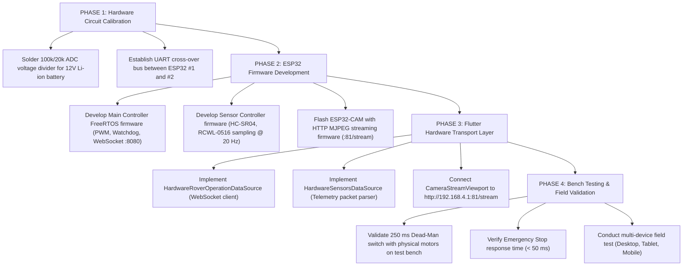

# ROVER COMMAND — Technical Gaps & Future Roadmap

**Document ID**: `AUDIT-13-GAPS-ROADMAP`  
**Classification**: Gap Analysis & Future Engineering Roadmap  
**Project**: ROVER COMMAND  
**Root Workspace**: `D:\projects\AAC FLUTTER`  

---

## 1. Technical Gap Analysis

To maintain architectural integrity, this document explicitly details every technical gap between the current Flutter software and physical hardware integration.

```
+-----------------------------------------------------------------------------------+
| AREA                       CURRENT REALITY            TARGET PRODUCTION REALITY   |
+-----------------------------------------------------------------------------------+
| Frontend UI Architecture   100% Implemented & Tested  Ready for live operations   |
| Multi-Device Layouts       100% Implemented & Tested  Desktop, Tablet, Mobile     |
| Zoom Engine                100% Implemented & Tested  GPU Matrix, WPT Pinch-Ready |
| Remote Movement Controls   100% Implemented & Tested  WASD/Arrow & D-Pad with E-Stop|
| Data Layer Abstractions    100% Implemented & Tested  Repository & DataSource contracts|
| Simulated Data Layer       Active                     Realistic deterministic demo|
| Live Hardware Transport    Abstracted / Planned       WebSocket / UDP / MJPEG     |
| Microcontroller Firmware   Not in repository          ESP32 FreeRTOS C++ firmware |
| Battery Voltage Circuit    Missing in hardware circuit Requires 100k/20k ADC divider|
| Inter-ESP32 Hardware Bus   Missing in hardware circuit Requires UART / ESP-NOW bus |
+-----------------------------------------------------------------------------------+
```

---

## 2. Detailed Gap Breakdown

### 2.1 Gap 1: Physical Battery Voltage Measurement Absence
* **The Root Cause**: As established in `design_reference/hardware_circuit.jpeg`, the physical hardware schematic lacks a voltage divider or current sensor connected to an ESP32 ADC pin.
* **The Solution**:
  1. Add a high-impedance voltage divider ($100\text{ k}\Omega$ and $20\text{ k}\Omega$, division ratio $6.0$) from the 12V Li-ion rail to an ADC1 pin (e.g. `GPIO34` or `GPIO35` on the ESP32). Note: Avoid ADC2 pins as ADC2 is disabled when Wi-Fi is active!
  2. Calibrate ADC readings against a multimeter to calculate actual battery percentage.

### 2.2 Gap 2: Microcontroller Firmware & Communication Server
* **The Root Cause**: The repository is exclusively a Flutter client application. No C/C++ firmware exists for the two ESP32 DevKit boards or the ESP32-CAM.
* **The Solution**: Develop modular FreeRTOS C++ firmware:
  * **Module A (Main Controller)**: Manages Wi-Fi SoftAP, WebSocket server on port `8080`, DRV8833 PWM motor control, and dead-man watchdog timer ($250\text{ ms}$).
  * **Module B (Sensor Controller)**: Samples HC-SR04 ultrasonic sensors and RCWL-0516 radar; streams data via UART to the Main Controller.
  * **Module C (ESP32-CAM)**: Hosts an HTTP multipart MJPEG video server on port `81/stream`.

### 2.3 Gap 3: Live Data Source Implementation
* **The Root Cause**: `DependencyContainer` currently binds `DemoRoverOperationDataSource`, `DemoSensorsDataSource`, and `DemoCameraDataSource`.
* **The Solution**:
  * Create `lib/features/rover_operation/data/datasources/hardware_rover_operation_data_source.dart` implementing `RoverOperationDataSource`.
  * Open a WebSocket client connection to `ws://192.168.4.1:8080`.
  * In `DependencyContainer._initRepositories()`, switch data source instantiation from `Demo*` to `Hardware*` (or toggle based on a configuration setting).

---

## 3. Step-by-Step Implementation Roadmap



---

## 4. Advanced Future Feature Concepts

1. **Autonomous Waypoint Navigation**: Utilizing wheel encoders and IMU dead-reckoning to allow the operator to tap coordinates on a 2D map for autonomous transit.
2. **Computer Vision Obstacle Bounding**: Ingesting ESP32-CAM frames into a lightweight on-device TensorFlow Lite model to overlay real-time bounding boxes around detected hazards.
3. **Telemetry Black-Box Logging**: Exporting flight-recorder session logs in CSV / JSON format for post-mission engineering review.
4. **Sunlight-Readable High-Contrast Mode**: A dedicated high-visibility display profile for harsh outdoor desert environments.

